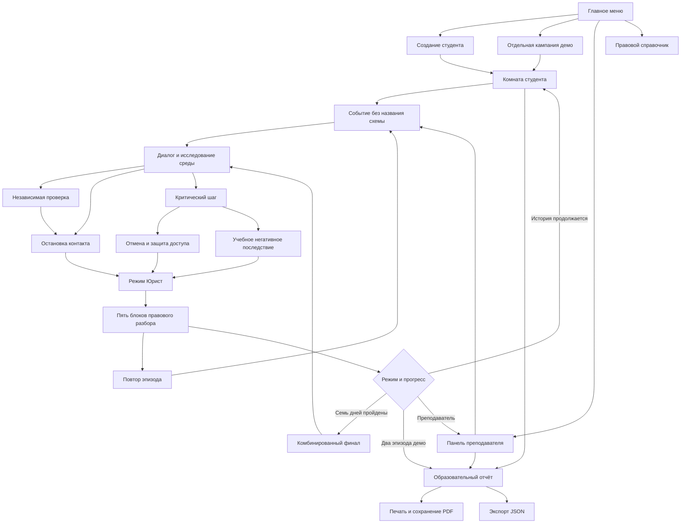

# Схема переходов

Идентификаторы дней: 1 звонок, 2 сообщение, 3 магазин, 4 аренда, 5 работа, 6 инвестиции, 7 видеосообщение, 8 комбинированный финал. При обычной игре с комнаты доступен первый незавершённый день; выбор сценария позволяет отдельно переиграть день. Финал закрыт до семи завершённых глав; преподавателю доступен сразу.
